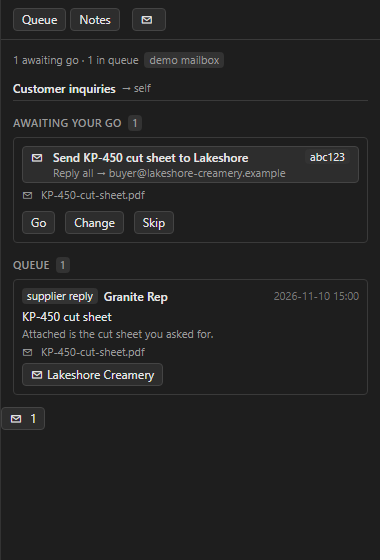
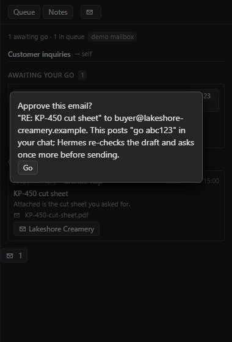
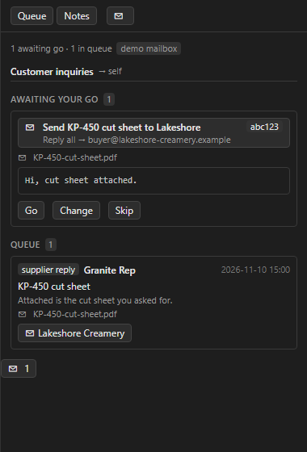
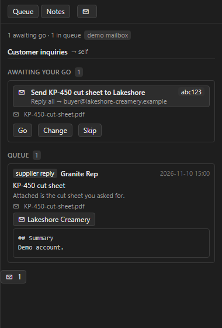

# Inbox Chief — Hermes plugin

An Outlook inbox chief of staff for Hermes, for personal Outlook.com and Microsoft 365 accounts.
It watches your mailbox the way a good
assistant would, then hands you finished drafts to approve:

- **One owner per email.** Each new message is routed to exactly one lane (quotes, accounting, sales,
  or whatever lanes you define). A lane is owned by you or by one of your Hermes specialist profiles.
- **Catches what slips.** It flags customer replies on threads *you* started, supplier answers to your
  questions, replies you owe, and follow-ups that have gone overdue. Each reply alerts once. There
  are no repeats between chat and scheduled scans.
- **Connects the dots.** When a supplier's cut sheet or answer arrives, it finds the customer thread
  that is *possibly waiting on this*. It matches on fuzzy supplier names, part and quote numbers,
  timing and account notes. A shared parent company never counts as a match.
- **Go/no-go drafts.** Drafts are staged as **reply-all** in your Outlook Drafts folder, and Hermes
  asks you for go, change or skip. Nothing is sent until you say go.
- **Shared account notes.** Markdown notes per customer or supplier, kept in a folder a team can
  sync, are pulled into context automatically when a thread mentions that account.
- **Desktop panel.** A right-side pane in Hermes Desktop shows lane queues, drafts awaiting your go
  (with Go / Change / Skip) and account notes, plus a pending-count chip in the status bar.

| Lane queue | Approve (Go) | Draft preview | Account note |
|---|---|---|---|
|  |  |  |  |

<sub>Screenshots: the real `desktop/plugin.js` rendered against fictional demo data
(`scripts/render_panel_previews.mjs`). Inside Desktop, the app's own theme replaces the preview styling.</sub>

Requires Hermes **0.22.3 or newer**. Microsoft sign-in is configured for **personal Outlook.com /
Hotmail / Live** mailboxes and **Microsoft 365 work or school** mailboxes. A Microsoft account
without an Outlook mailbox is not enough. Gmail, other IMAP services and on-premises Exchange
are not implemented. Offline fixture mode needs no Microsoft account.

## Install

```bash
hermes plugins install inbox-chief          # from the catalog, at the reviewed commit
hermes plugins enable inbox-chief           # if you didn't enable it at install
```

Restart the gateway (or Hermes Desktop) so the tools, hooks and panel backend load. The Desktop
pane is opt-in: turn it on in **Desktop → Capabilities → Plugins → Inbox Chief**.

**Try it offline first.** Set `mailbox` to `fixture`. Inbox Chief then runs against a bundled, fully
fictional demo mailbox and never touches real mail:

```bash
hermes config set plugins.entries.inbox-chief.settings.mailbox fixture
```

Then ask Hermes *"scan my inbox"* or type `/inbox`.

## Microsoft sign-in

Inbox Chief uses **your own** Entra app registration, not another vendor's client ID. App
registration requires access to an Entra directory; the **mailbox user does not have to belong
to it**. A personal Outlook.com demo mailbox needs no Microsoft 365 subscription. There is no
client secret, and Hermes holds the token, not the plugin. No shared publisher client ID is bundled.

1. **Register the app** in the Microsoft Entra admin center → *App registrations → New registration*.
   Choose **Any Entra ID Tenant + Personal Microsoft accounts** (also worded *Accounts in any
   organizational directory and personal Microsoft accounts*). Its `signInAudience` is
   `AzureADandPersonalMicrosoftAccount`. An organizational-only or single-tenant registration
   will not enable the personal-account path just because the plugin uses `/common`.
2. Under **API permissions → Microsoft Graph → Delegated**, add `Mail.ReadWrite`, `Mail.Send`,
   `User.Read` and `offline_access`. No application permissions or client secret. Work tenants can
   require administrator approval; personal users consent for their own mailbox.
3. Give Hermes the **Application (client) ID**, which is not a secret. Use *Desktop → Plugins →
   Inbox Chief*, or run `hermes config set INBOX_CHIEF_MS_CLIENT_ID <client-id>`.
4. Configure the **Mobile and desktop / public-client redirect** using the exact callback URI
   Hermes prints, including port and `/callback`. The current Hermes plugin flow chooses a random
   `127.0.0.1` port; do not assume Microsoft's documented `localhost` port exception applies to it.
   The setup guide below explains how to register the URI while the sign-in waits.
5. Sign in **from your own terminal**, using a private browser window and the intended account:
   ```bash
   hermes auth add inbox-chief:microsoft --no-browser --timeout 900
   hermes auth status inbox-chief:microsoft
   ```
   `prompt=select_account` asks you to choose; it is not a test-mailbox identity guarantee.

For the exact app/redirect steps and an isolated demo home, see
[`docs/DEMO_MAILBOX_SETUP.md`](docs/DEMO_MAILBOX_SETUP.md). That guide also covers a personal-account
setup without purchasing a test tenant. Existing grants made under `/organizations` need a fresh
sign-in because the declaration changed. `hermes auth logout inbox-chief:microsoft` removes a grant.

**Live compatibility is not yet verified.** Offline tests cover the dual-audience manifest, client
contract and no-send safety; they cannot prove a real Microsoft login. A known Hermes scope-echo
check can reject `offline_access` or differently formatted Graph scopes with
`oauth_scope_not_granted`. Report the sanitized error, not tokens or authorization URLs. That
requires an upstream Hermes fix, not a plugin token-storage workaround. See SPEC.md §7.

**Teams.** Each person installs the plugin and signs in with their own Microsoft account. Grants and
runtime state are per user and per Hermes profile. The lanes file and the account-notes folder can
be shared, for example in a synced folder. Neither one holds credentials.

## Lanes config

Company specifics (your domains, suppliers, customers and lane rules) live in **your own private
YAML file, outside the plugin folder**. Start from [`lanes.example.yaml`](lanes.example.yaml), which
describes a fictional company:

```bash
hermes inbox-chief check-config ~/inbox-chief/lanes.yaml
hermes config set plugins.entries.inbox-chief.settings.lanes_file ~/inbox-chief/lanes.yaml
```

| Section | Purpose |
|---|---|
| `company` | `internal_domains` (who counts as "us") and `my_addresses` |
| `hours` | Timezone, days and window for scheduled scans. Manual scans always run. |
| `noise` | Extra sender/subject regexes to ignore, on top of the built-in no-reply and newsletter filters |
| `suppliers` | Name, domains, the aliases people actually type, and `parent` (never a link signal on its own) |
| `customers` | Optional aliases for thread linking and account notes |
| `lanes` | `id`, `owner` (`self` or a Hermes profile name), `priority` (first match wins), `detect`, `match` rules, `replies_owed` timing |
| `followups` | Business days before a sent email that needs a reply is flagged overdue |
| `safety` | Extra pricing patterns and attachment names, and `allow_pricing_to` domains |

**Plugin settings** (`plugins.entries.inbox-chief.settings.*`, or Desktop → Plugins):

| Setting | Default | Meaning |
|---|---|---|
| `lanes_file` | `""` | Path to your lanes YAML. Empty means setup mode. |
| `notes_dir` | `""` | Folder of markdown account notes. Empty turns notes off. |
| `mailbox` | `graph` | `graph` = your personal Outlook.com or Microsoft 365 mailbox; `fixture` = offline demo mailbox |
| `fixture_path` | `""` | Custom fixture mailbox JSON for `mailbox: fixture` |
| `send_confirmation` | `approval_gate` | `approval_gate` = Hermes approval prompt before every send; `explicit_go` = your latest chat message must be a go for that draft |
| `go_phrases` | `[]` | Extra phrases that count as a go in `explicit_go` mode |
| `scan_lookback_days` | `2` | How far back a scan looks |
| `owner` | `""` | Which lane owner this profile acts as. Empty means the profile name. |
| `signature` | `""` | Plain-text signature appended to drafts |

**Scheduled scanning (optional).** Run `/blueprint inbox-chief:scan`, or use *Desktop → Cron →
Blueprints*. You pick the hours and days; the default is every 15 minutes, 6:00–18:00 on weekdays.
A scan stays silent when nothing is new and **never sends**.

## Using it

- *"What's in my inbox?"* or `/inbox` shows lane queues and drafts awaiting your go.
- *"Draft a reply to the Lakeshore email with the cut sheet attached"* stages a reply-all draft and
  shows it to you.
- **`go`** (or `go <id>` when several drafts are waiting) sends that draft. **`change <id>: …`**
  revises it. **`skip`** drops it from the list and leaves the Outlook draft untouched.

Tools: `inbox_chief_status`, `inbox_chief_scan`, `inbox_chief_thread`, `inbox_chief_draft_reply`,
`inbox_chief_draft_new`, `inbox_chief_pending`, `inbox_chief_send`, `inbox_chief_resolve`,
`inbox_chief_notes`. Hooks: `pre_llm_call` (account-note and pending-draft context) and
`pre_tool_call` (the send gate). The plugin also adds a `/inbox` command, the `hermes inbox-chief`
CLI, an `inbox-chief:triage` skill and an `inbox-chief:scan` automation blueprint.

## Safety model

Every rule below is enforced in code and covered by tests, not left to the prompt.

1. **Sends only on your explicit go.** By default every `inbox_chief_send` goes through Hermes's own
   approval prompt. In `explicit_go` mode, your latest chat message must be a go for *that* draft.
   There is no auto-send setting.
2. **Never sends from unattended runs.** Both the tool and the `pre_tool_call` hook refuse to send
   from cron jobs, scheduled scans, subagents or kanban workers.
3. **Sends exactly the draft you reviewed.** If the draft changed after it was staged, the send is
   refused.
4. **Reply-all is the default.** CC is kept. Sender-only is an explicit opt-out
   (`sender_only: true`), and any other value never downgrades the reply.
5. **Never forwards supplier pricing.** A draft that would carry a supplier's quote, price list or
   price figures to anyone outside your company (or that supplier) is refused.
6. **Minimal mailbox writes.** The plugin never deletes, moves or creates rules. It only writes
   drafts and draft attachments, sets the reply/reply-all icon on the message you answered, and sends
   drafts you approved.
7. **The Desktop panel cannot send.** Its backend has no send route. **Go** asks for confirmation,
   then posts `go <id>` into your focused chat, so rules 1–3 still apply.
8. **Stale drafts drop off.** The pending list is checked live against Outlook, so drafts you sent
   or deleted yourself disappear from it.

## Disclosures

What you should know before installing (catalog rule 13):

- **Network calls:** Microsoft only. Mail goes through Microsoft Graph (`graph.microsoft.com`) and
  sign-in through `login.microsoftonline.com`. Because these are two different Microsoft domains,
  `hermes plugins validate` warns that the OAuth `hosts` share no domain with the token URL. That
  warning is expected. There are no other services, **no telemetry** and no usage reporting.
- **Stored credentials:** one Microsoft OAuth grant (delegated `Mail.ReadWrite`, `Mail.Send`,
  `User.Read`, `offline_access`). Hermes signs in, stores the grant in the active profile's auth
  store and refreshes it (`oauth:` in `plugin.yaml`). The plugin calls Graph only through Hermes's
  `credentialed_provider_request`. It never sees the token and never reads `.env`, `auth.json` or
  any other credential file. `INBOX_CHIEF_MS_CLIENT_ID` is a public client ID, not a secret.
- **Mailbox access:** the plugin reads your Inbox and Sent Items within the scan lookback window, and
  the drafts it staged. It writes drafts, draft attachments and the reply-icon property (MAPI
  `0x1081`), and it sends drafts you approved, as described in the safety model.
- **Reads outside the plugin's own data:** your `lanes_file`, your `notes_dir`, and `fixture_path`
  if you set one.
- **Writes outside the plugin's own data:** dated log lines appended to account notes in your
  `notes_dir`, with older lines moved to `notes_dir/_archive/`. All other state lives in Hermes's
  per-profile plugin state.
- **Background work:** none by default. The plugin runs no threads, daemons or polling. Scans run
  when you ask, or on the cron blueprint if you schedule it.
- **Shell commands:** none. **Self-updating:** none. Updates arrive only through catalog SHA bumps.
- **Dependencies:** no Python dependencies beyond Hermes itself. `ruamel.yaml` and `pytest` are only
  used for development and tests.
- **Dev-only scripts (never loaded by Hermes):** `scripts/load_demo_mailbox.py` seeds an *empty test
  mailbox* with the fictional demo dataset. It refuses to run if the signed-in mailbox isn't the one
  you name, if its Inbox has more than 25 messages, or if demo data is already present (unless the
  operator explicitly overrides the latter two checks). `scripts/render_panel_previews.mjs` makes the README
  screenshots; its HTML loads Tailwind from `cdn.jsdelivr.net` when opened.

## Development

```bash
uv run --isolated --no-project --python 3.12 --with "pytest>=8,<9" --with "ruamel.yaml>=0.18,<0.19" python -m pytest
node tests/desktop/render_harness.mjs     # headless panel render + Go/Change/Skip (needs react, react-dom, jsdom)
hermes plugins validate . --install-deps
hermes plugins doctor . --ci
```

Tests run offline only; a guard fails any test that opens a network connection. The recorded demo
uses a separate personal Outlook.com or Microsoft 365 test mailbox, never your real mail:
see [`docs/DEMO_MAILBOX_SETUP.md`](docs/DEMO_MAILBOX_SETUP.md).
Design and catalog-compliance notes are in [`SPEC.md`](SPEC.md).

License: MIT
