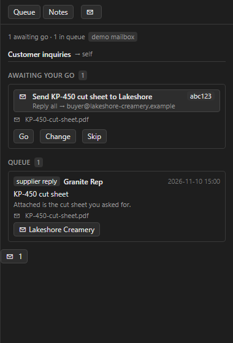
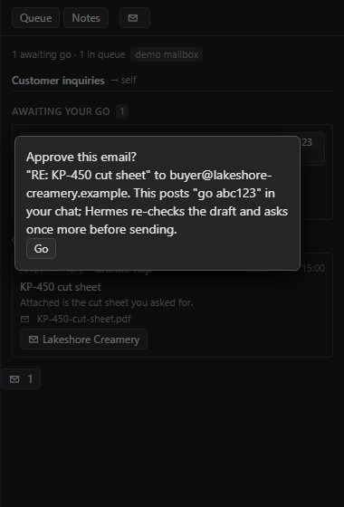
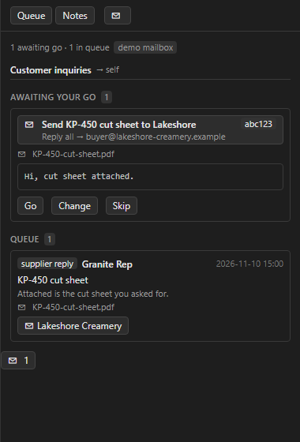
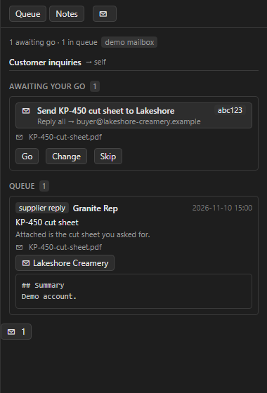

<!-- PR title: plugin-catalog: add inbox-chief (Outlook inbox chief of staff) -->

## What it does

**Inbox Chief** turns Hermes into an Outlook (personal Outlook.com or Microsoft 365) inbox chief of staff:

- routes each new email to **one owner lane** (you or one of your Hermes specialist profiles), with
  configurable match rules, noise filters and business hours
- catches **customer replies on threads you started**, supplier replies, replies you owe and overdue
  follow-ups. Each reply alerts once, with no duplicates between chat and scheduled scans
- links a supplier's answer to the customer thread **possibly waiting on it**, using fuzzy supplier
  names, part/quote tokens, timing and account notes (a shared parent company is never a link signal)
- stages **reply-all** drafts in Outlook and **sends only after the user's explicit go**
- injects shared markdown account notes into context (`pre_llm_call`)
- Desktop right pane: lane queues, drafts with Go / Change / Skip, account notes, and a status-bar
  pending chip

Company specifics live in the user's own private lanes YAML outside the plugin. The repo ships only a
fictional example and a fictional demo mailbox, so the plugin runs offline with `mailbox: fixture`.

Microsoft sign-in uses `/common` and explicitly prompts for account selection. A dedicated Entra
app supporting organizational and personal accounts is still required; no publisher client ID is
bundled. The mailbox can be a personal Outlook.com account without an M365 subscription. Live
sign-in and demo seeding remain pending: the current Hermes scope-echo check and exact loopback
redirect registration are documented limitations in `docs/DEMO_MAILBOX_SETUP.md`, not verified
end-to-end compatibility. No production mailbox was used to test this change.

## Hermes surfaces used

- `ctx.register_tool` ×9 (`inbox_chief_*`), `ctx.register_hook` (`pre_llm_call`, `pre_tool_call`)
- `ctx.register_command` (`/inbox`), `ctx.register_cli_command` (`hermes inbox-chief`)
- `ctx.register_skill` (`inbox-chief:triage`), `ctx.register_automation_blueprint` (`inbox-chief:scan`, user-scheduled)
- `ctx.state`, `ctx.get_config`, `ctx.current_cron_execution`
- `plugin.yaml` `oauth:` (`microsoft`) + `credentialed_provider_request` for Microsoft Graph
- Desktop plugin SDK only (`desktop/plugin.js`: pane, status-bar chip, palette entry; `ctx.rest` to
  its own `dashboard/plugin_api.py`; `host.composer` to post `go <id>` into the focused chat)

There is no core patching and no undocumented core imports. `register()` does no I/O.

## Validation

Public repository: https://github.com/andrewjsoukup/hermes-inbox-chief

Pinned commit: `44160006ddcb29e3e71747cda2e760ceb01a0906`.

An anonymous fresh clone was checked out at that exact commit, then
`hermes plugins validate <checkout> --install-deps` passed on Hermes v0.22.7:

```
✓ manifest / manifest fields / requires_hermes '>=0.22.3' / config schema / requires_env / oauth
✓ loadable — entry: __init__.py, desktop/plugin.js
✓ python dependencies — none declared
✓ capability probe / declared tools / declared hooks / declared middleware / built-in tool collisions
✓ security scan — safe
✓ no core override
✓ desktop surface — stays inside the plugin SDK surface
⚠ oauth 'microsoft': host graph.microsoft.com shares no domain with login.microsoftonline.com
Validation passed.
```

The one warning is expected: Microsoft's sign-in (`login.microsoftonline.com`) and Graph API
(`graph.microsoft.com`) are both Microsoft-owned and are the documented endpoints for delegated Graph
scopes. The validator completed with exit code 0 despite a separate pre-existing local-launcher
source-update warning; no Hermes update or service restart was performed for publication.
The current test suite passes all 180 offline tests with FastAPI available (178 pass, 2 skip without it),
plus a headless jsdom render of the Desktop pane that clicks Go/Change/Skip; a guard fails any test
that opens a network connection.

## Disclosures (rule 13)

- **Network:** Microsoft Graph (`graph.microsoft.com`) and Microsoft sign-in
  (`login.microsoftonline.com`) only. No other third parties, no telemetry, no usage reporting.
- **Stored credentials:** one Microsoft OAuth grant (delegated `Mail.ReadWrite`, `Mail.Send`,
  `User.Read`, `offline_access`) on the **user's own** Entra app. It is signed in with
  `hermes auth add inbox-chief:microsoft` and stored and refreshed by Hermes. The plugin uses it only
  through `credentialed_provider_request` and never reads `.env`, `auth.json` or token files.
  `INBOX_CHIEF_MS_CLIENT_ID` is a public PKCE client ID (`secret: false`), and there is no client
  secret.
- **Mailbox access:** reads Inbox and Sent Items within the lookback window, plus its own staged
  drafts. Writes drafts, draft attachments and the reply/reply-all icon property (MAPI `0x1081`).
  Sends a draft only after the user's explicit go: through Hermes's approval prompt by default, or
  `explicit_go` mode where the user's latest message must be a go for that draft. It never sends from
  cron, subagents or kanban workers (blocked in both the tool and the `pre_tool_call` hook), refuses
  drafts edited after staging, and refuses drafts that would forward supplier pricing outside the
  company. It never deletes, moves or creates rules.
- **Reads outside plugin data:** the user's `lanes_file`, `notes_dir` and optional `fixture_path`.
- **Writes outside plugin data:** dated log lines appended to account notes in `notes_dir`, with
  overflow in `notes_dir/_archive/`.
- **Background processes:** none. Scanning runs on request or on the cron blueprint if the user
  schedules it.
- **Shell commands:** none. **Self-updating:** none. **Binaries / bytecode:** none.
- **Python dependencies:** none.
- **Dev-only scripts (not loaded by Hermes):** `scripts/load_demo_mailbox.py` seeds an empty test
  mailbox with the fictional dataset. It refuses unless the signed-in mailbox matches
  `--expect-mailbox` and the mailbox is nearly empty, and it never sends, moves or deletes.
  `scripts/render_panel_previews.mjs` renders README screenshots (its HTML loads Tailwind from
  jsDelivr).

## Screenshots

| Lane queue | Approve (Go) | Draft preview | Account note |
|---|---|---|---|
|  |  |  |  |

All four pinned image URLs returned HTTP 200 with PNG content matching the committed files.

Demo video: recording/upload pending; the owner will add the X post link before final submission.

I am the repository owner (rule 5).
